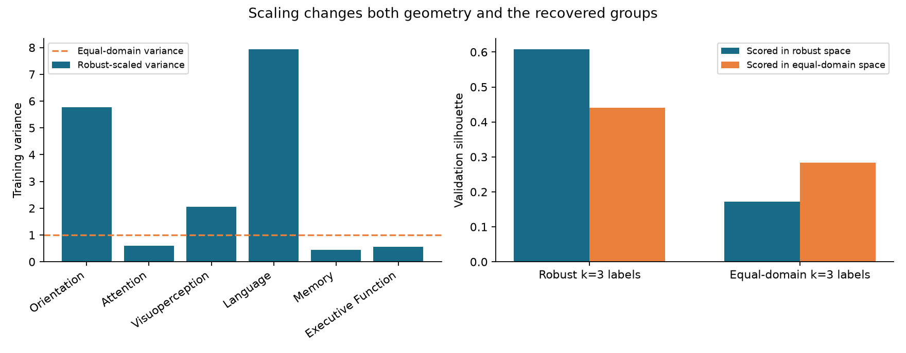
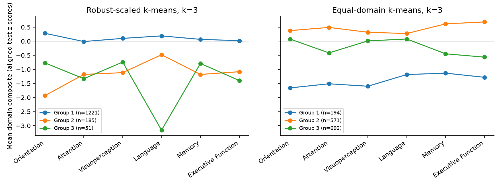
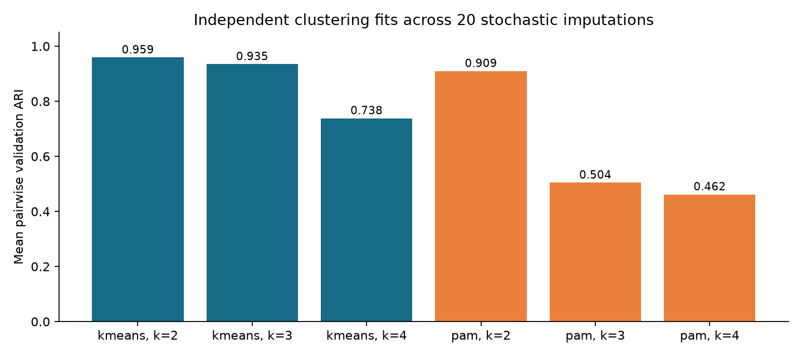
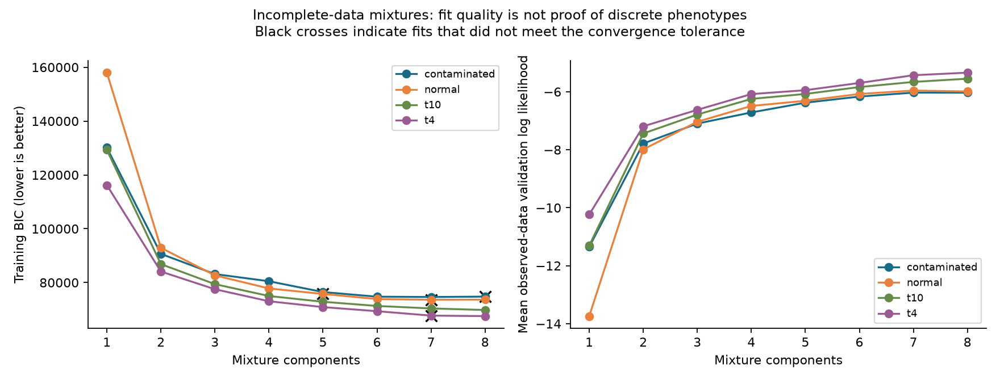

# Implemented clustering extension: results

Analysis date: 15 October 2026.

**Main conclusion:** reproducible partitions exist, but their interpretation is strongly dependent on scaling, imputation and model family. The new analysis does not establish a unique set of discrete cognitive phenotypes. It adds evidence for stable score groupings and identifies measurement effects that must be addressed before stronger clinical claims.

Verified 17,406 assessments from 7,285 patients. The new cross-sectional experiment uses the earliest eligible assessment per patient, with **5,828 discovery and 1,457 validation patients**. The saved eligible matrix exactly matches the current spreadsheet. Source hashes and row mappings are recorded locally. No raw data were uploaded.

The audit recovered an eligibility discrepancy: the saved matrix and NB0 retain rows with at least one observed retained test, not a maximum 50% missingness rule. There are 16,553 assessments and 6,602 index patients with at least seven observed tests. The primary experiment preserves the historical eligible cohort and assesses that stricter rule separately.

**Implemented changes and checks**

Shared clipping, test-direction alignment, variable standardization and domain aggregation now replace the duplicated NB5/NB14 logic. New preprocessing is fitted on discovery patients only. NB15–NB17 call reproducible Python stages. Historical result files remain untouched; new outputs are under `results/research_2026/`.

The corrected aggregation materially changes the old descriptive comparison: three-group k-means ARI between old and corrected preprocessing is **0.703** over all assessments and **0.629** over complete cases. Attention composites correlate **-0.749**, consistent with the importance of reversing the timed test. These are controlled aggregation checks, not a rerun of every legacy H1–H4 statistic.

The code implements and tests observed-data Gaussian, fixed-df t (4 and 10), and fixed-contamination (90% core, 10% tenfold covariance) mixtures. Missing coordinates are integrated out. It also implements sampled PAM, independently refitted imputation ensembles, and a linear trajectory mixture with integrated patient random effects. These are native implementations, not exact reproductions of the published R packages.

**Original-space comparisons**

| model | train_silhouette | validation_silhouette | validation_coverage | train_minimum_cluster_fraction |
| --- | --- | --- | --- | --- |
| domains:kmeans:2 | 0.666 | 0.649 | 1.000 | 0.115 |
| domains:pam:2 | 0.553 | 0.540 | 1.000 | 0.238 |
| domains:gmm_full:8 | 0.117 | 0.118 | 1.000 | 0.038 |
| domains:gmm_tied:5 | 0.548 | 0.535 | 1.000 | 0.024 |
| residual:kmeans:3 | 0.547 | 0.532 | 1.000 | 0.026 |
| residual:pam:2 | 0.500 | 0.508 | 1.000 | 0.111 |
| residual:gmm_full:7 | 0.139 | 0.125 | 1.000 | 0.034 |
| residual:gmm_tied:5 | 0.482 | 0.495 | 1.000 | 0.022 |
| without_orientation:kmeans:2 | 0.722 | 0.711 | 1.000 | 0.075 |
| tests:kmeans:2 | 0.406 | 0.399 | 1.000 | 0.226 |
| hdbscan:15:100 | 0.389 | 0.400 | 1.000 | 0.326 |

The table selects partition/density models by discovery silhouette and GMMs by discovery BIC among converged solutions with at least 2% in each cluster. Silhouettes are measured in the indicated feature representation, not the UMAP embedding. Noise is excluded from silhouette and coverage is reported separately. Different representations define different geometries; their silhouettes are not a common performance scale.

Direct HDBSCAN assigned every patient to noise at both tested minimum cluster sizes (100 and 300, min_samples=20). UMAP+HDBSCAN recovered groups, but changing neighborhood size from 15 to 50 changed the recovered count and reduced separation in measured domain space. This is evidence of parameter and representation sensitivity, not a comprehensive rejection of density clustering.

**Scaling is a major source of sensitivity**

Robust scaling gives language and orientation variances 7.93 and 5.76, compared with 0.44 for memory. Tight central score ranges amplify the tails of ceiling-heavy tests. The robust-space first component explains 63.3%, but is dominated by language/orientation; it should not automatically be equated with a balanced general-cognition factor. Equal-domain scaling yields PC1 variance 58.5%.

At k=3, robust and equal-domain assignments agree at only **ARI 0.243**. The robust labels have validation silhouette 0.608 in their own geometry and 0.440 in equal-domain geometry. Equal-domain labels have corresponding values 0.172 and 0.283. The geometry sensitivity was added after inspecting training-set variances and is explicitly exploratory. Neither scaling is established as clinically correct.

Group numbers in the profile figure are local to each model; matching numbers/colors across panels do not identify the same patients.

**Refitting and imputation uncertainty**

| source | method | k | n_repeats | mean_ari | ari_p05 | ari_p95 |
| --- | --- | --- | --- | --- | --- | --- |
| imputation_draw | kmeans | 2 | 20 | 0.959 | 0.944 | 0.974 |
| imputation_draw | kmeans | 3 | 20 | 0.935 | 0.917 | 0.951 |
| imputation_draw | kmeans | 4 | 20 | 0.738 | 0.627 | 0.823 |
| imputation_draw | pam | 2 | 20 | 0.909 | 0.851 | 0.959 |
| imputation_draw | pam | 3 | 20 | 0.504 | 0.281 | 0.878 |
| imputation_draw | pam | 4 | 20 | 0.462 | 0.308 | 0.662 |
| patient_subsample | kmeans | 3 | 50 | 0.968 | 0.933 | 0.991 |
| initialization | kmeans | 3 | 50 | 1.000 | 1.000 | 1.000 |

These ARIs compare labels for the same held-out patients after independent discovery fits. The 5th–95th percentiles describe pairwise agreement variation; they are not confidence intervals, because pairs share fitted partitions. Patient subsampling refits preprocessing, imputation and k-means; initialization checks vary clustering seeds with the input fixed. Stochastic imputations use a bounded Bayesian chained-equations model, so their stability is conditional on that model.

The new cohort, representation and validation design differ from the historical assessment-level analysis. A numerically higher ARI is not evidence that the new model outperforms the original one. `selected_assignments.csv` links the selected reference labels to verified assessment and patient keys.

Per-cluster held-out Jaccard across patient subsamples (fixed three-group k-means):

| cluster | mean | min | max |
| --- | --- | --- | --- |
| 0 | 0.994 | 0.982 | 0.999 |
| 1 | 0.959 | 0.888 | 1.000 |
| 2 | 0.947 | 0.850 | 1.000 |

Equal-domain k-means imputation stability:

| k | mean_ari | ari_p05 | ari_p95 |
| --- | --- | --- | --- |
| 2 | 0.769 | 0.729 | 0.804 |
| 3 | 0.747 | 0.718 | 0.775 |
| 4 | 0.754 | 0.730 | 0.786 |

Other sensitivity comparisons (fixed k=3):

| experiment | n_train | n_validation | ari_vs_reference | validation_silhouette |
| --- | --- | --- | --- | --- |
| mean | 5828 | 1457 | 0.921 | 0.615 |
| knn | 5828 | 1457 | 0.538 | 0.423 |
| iterative | 5828 | 1457 | 1.000 | 0.608 |
| at_least_7_observed | 5263 | 1339 | 0.903 | 0.598 |
| no_clipping | 5828 | 1457 | 0.958 | 0.603 |
| iterative_50_iterations | 5828 | 1457 | 1.000 | 0.608 |
| independent_validation_discovery_fixed_training_transform | 1457 | 1457 | 0.895 | 0.588 |

These sensitivity silhouettes use the fixed reference domain geometry, including for the KNN and no-clipping assignments. Independent validation discovery fits clusters on validation patients under the frozen training transform; that row is an agreement diagnostic, not another held-out prediction score.

Test availability is associated with fixed three-group assignments on validation patients:

| variable | cramers_v | minimum_missing_fraction | maximum_missing_fraction |
| --- | --- | --- | --- |
| MRAVLT075 | 0.412 | 0.102 | 0.804 |
| FEPMR | 0.371 | 0.161 | 0.863 |
| OPERSONA | 0.362 | 0.004 | 0.216 |
| OTEMPS | 0.362 | 0.004 | 0.216 |
| MRAVLT015R | 0.356 | 0.181 | 0.882 |

These are descriptive associations, not evidence that missingness causes the groups. They show that administration patterns and impairment remain entangled. The smallest robust-space group has particularly high missingness in memory and executive tests. Stability under the same imputation assumptions does not remove this concern.

Across the 20 imputation draws, the k-means training-silhouette screen selected counts {2: 20}. This compares two through eight clusters and does not test the existence of groups against a one-population null.

Average-linkage and greedy mean-NMI consensus gave similar agreement for k-means k=2 and k=3. Generic NMF aggregation was unreliable here: the requested two-group k-means ensemble collapsed to one assigned group and hit the iteration limit; its three-group version produced only two assigned groups. Full results are saved in `ensemble_comparison.csv`. Consensus was calculated over held-out assignment vectors to summarize agreement; it is not an independently validated predictive model. A one-group silhouette is undefined.

**Incomplete-data models**

| family | selected_k | bic | validation_loglik | validation_silhouette | converged_fits | fits | lowest_bic_any_fit_k | selected_by_icl_k |
| --- | --- | --- | --- | --- | --- | --- | --- | --- |
| contaminated | 7 | 74641.783 | -6.030 | 0.154 | 7 | 8 | 7 | 6 |
| normal | 6 | 73878.439 | -6.076 | 0.188 | 6 | 8 | 7 | 6 |
| t10 | 8 | 69815.813 | -5.550 | 0.111 | 8 | 8 | 8 | 8 |
| t4 | 8 | 67545.558 | -5.341 | 0.095 | 7 | 8 | 8 | 8 |

The grid contains 32 fits, of which 28 meet the requested numerical convergence criterion. Selected models must converge and assign at least 2% of discovery patients to every component. A dispersion-matrix eigenvalue floor of 0.02 (the scale matrix for t models) regularizes singular fits to bounded/discrete scores; BIC is an exploratory comparison of these approximations, not a test of biological classes. More components can fit skewness, ceiling masses and other distributional features. A best fit at the search boundary does not establish an optimum. These likelihoods may be compared within this 14-test data representation, not with GMM likelihoods in six-domain space.

The t family with four degrees of freedom has the best BIC and validation likelihood among the selected restricted families. Both t families still select eight components, the upper search boundary. Their low six-domain silhouettes and unresolved component count argue for treating them as density models with uncertain memberships, not adopting eight clinical phenotypes. Gaussian and contaminated-normal selection also differs, and ICL selects six rather than seven components for the contaminated model.

The reported silhouette for these models evaluates their assignments in the completed six-domain robust-scaled representation; their likelihood fits integrate missing values directly in the 14-test representation. Selected assignments and model-conditional membership probabilities are saved with verified keys in `incomplete_assignments.csv`. Probabilities do not capture uncertainty about the model family, component count or missingness mechanism.

**Continuous-reference check**

A matched-size 1,000-patient screen compared k-means k=2–8 with 100 single-Gaussian-copula reference datasets, preserving empirical discrete margins and resampling joint missingness masks. The observed maximum silhouette was 0.676; its fitted-reference tail fraction was 0.0099. The PC1 dip-statistic tail fraction was 0.9901. The positive control recovered 2 groups with silhouette 0.917.

The criteria disagree. The silhouette result suggests structure beyond this particular fitted reference, while the dip statistic does not show excess multimodality relative to it. This is a descriptive calibration: the null is estimated from these data, missingness is resampled independently of simulated values, and the screen does not reproduce selection across every model family. It does not establish an omnibus p-value for clinical phenotypes or exclude other continuous explanations.

**Longitudinal analysis**

| k | n_train | n_validation | converged | bic | validation_loglik | minimum_train_class_fraction |
| --- | --- | --- | --- | --- | --- | --- |
| 1 | 1590 | 423 | True | 8376.347 | -2.598 | 1.000 |
| 2 | 1590 | 423 | True | 7572.232 | -2.403 | 0.039 |
| 3 | 1590 | 423 | True | 6806.030 | -2.290 | 0.027 |
| 4 | 1590 | 423 | True | 6465.485 | -2.212 | 0.013 |

The included cohort contains 2,013 patients. The convergence and 5% minimum-class rule selects **1 trajectory class**. The two-, three- and four-class fits improve likelihood but each introduces a class below the size threshold. This does not establish that recovery is homogeneous; it leaves nonlinear continuous variation and small genuine subgroups unresolved.

The trajectory experiment requires at least three sufficiently observed visits, a 0.25–5 year observed span, distinct times and a constant recorded injury age. It models the cognitive score over elapsed time from the first eligible assessment, integrating random intercept/slope uncertainty. This is a selected follow-up cohort and an exploratory course model, not a causal recovery model. More complex solutions improve likelihood but require inspecting small classes and departure from a linear Gaussian trajectory. The supplied selection rule requires at least 5% expected membership in every class. Repeated cognition is not an independent functional endpoint.

**Implications for the thesis**

Retain the interpretation of broad cognitive score/severity structure, while acknowledging that the dominant direction is sensitive to domain weighting. Qualify categorical phenotype claims. Report both robust and equal-domain geometries, since they produce different groups. Treat the independent-imputation result as an extension of H2, distinct from the earlier fixed-reference ARI. Recalculate legacy sensitivity statistics with the corrected preprocessing before replacing their thesis tables. Do not translate improved fit or stable assignments into treatment recommendations without external outcomes or cohort replication.

**Remaining limits and deviations from the proposed protocol**

The supplied data lack a verified episode-level assessment identifier and independent rehabilitation outcome. Variable selection was inherited from the historical full cohort. Imputation assumes an ignorable mechanism; bounded posterior draws do not solve MNAR. Some iterative imputers hit their iteration limit; extending deterministic imputation to 50 iterations converged after 37 and left the three-group labels unchanged. The skew-t and the published contaminated multivariate longitudinal model were not ported; the implemented restricted families make their assumptions explicit. PCA/dip diagnostics and fitted-reference simulations were run; a calibrated Silverman test was not implemented. The null simulation is narrower than the proposed full-procedure calibration and the positive control is an easy separated-group check, not a power study. The code uses native ensemble methods, not an exact reproduction of the paper authors' software. No superiority claim is made for an unimplemented method.

The recent evidence motivating this work is documented in the [research review](clustering_research_2026.md): [incomplete-data mixtures](https://doi.org/10.18637/jss.v115.i03), [multiple-imputation ensembles](https://doi.org/10.1186/s12874-026-02869-2), [clusterability](https://doi.org/10.5334/jors.389), and [longitudinal comparisons](https://doi.org/10.1186/s12874-026-02882-5). All cited articles are within the requested one-year publication window.

Reproduce with `analysis/run_research.ps1` using the project research environment. Source versions, dependency versions, input hashes and output hashes accompany the results. Numerical unit tests cover reference likelihoods, complete-data agreement, missing-data recovery, EM monotonicity, preprocessing direction, medoids, integrated trajectory likelihood and ensemble objective calculations.
